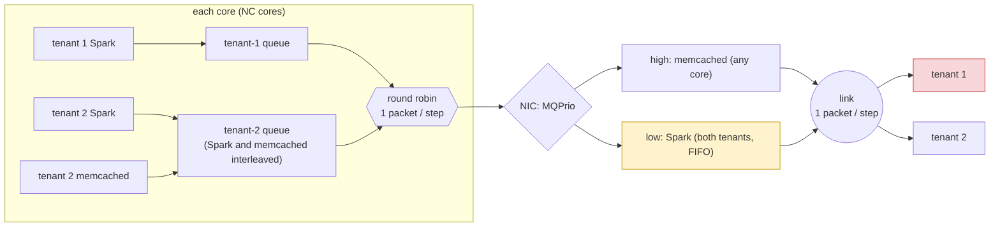

# Case study D: tenant isolation on a multi-queue NIC (Loom / MQPrio)

*Draft, in the style of `draft/case-studies-intro.md`.*

**The contention point.** A server's NIC transmits for two tenants over one link. Tenant 1 runs a
Spark job. Tenant 2 runs Spark and memcached. The intended policy is the one Loom (NSDI'19) argues
for:
1. the tenants share the link fairly;
2. within tenant 2, latency-sensitive memcached goes before its own Spark traffic.

Linux's MQPrio cannot express this hierarchy. It maps traffic classes to NIC queues, so the closest
configuration puts every memcached packet in a high-priority NIC queue and all Spark packets, of
either tenant, in a low-priority one. FPerf models exactly this pipeline (`LoomMQPrio`). Each core
has one queue per flow, a per-core stage that interleaves tenant 2's two flows, and a per-core round
robin between the tenants. Then the NIC sorts the cores' packets into the two priority queues, strict
priority sends one packet per step, and a demultiplexer returns it to its tenant.

**The bad event `Q`.** Tenant 1 is *starved* in a window of W = 20 steps (after 40 steps of warm-up)
when two things hold:
- it had packets waiting at every step of the window;
- it still received at most 40% of the window's packets, where its fair share is 50%.

The first condition matters. FPerf's own query ("tenant 2 receives more than 3 packets more than
tenant 1") also holds when tenant 1 simply has nothing to send. That is not an isolation failure.

**The input parameters.** Offered loads as fractions of the link: ρ₁ (tenant 1 Spark), ρ₂ (tenant 2
Spark), ρ_m (memcached). Each core's flow of a kind sends a packet per step with probability ρ/NC.

**The model.** `buffy/examples/jani/loom_isolation.buffy` is a DTMC whose only randomness is in the
arrivals. `POLICY` selects the NIC:
- 0: MQPrio, as above;
- 1: the hierarchical policy. There is one NIC queue per tenant, with tenant 2's memcached ahead of
  its own Spark, and a round robin between the tenants.

Everything before the NIC is the same under both policies. The model has 317 state variables at 4
cores with queue capacity 10 (585 at 8 cores), too large for exact checking. Numbers come from the
native JANI simulator (`src/netmdp/sim`), with 20,000 runs per point and 95% CI half-width at most 0.007.

**Validation.**
- With its defaults and `POLICY = 0`, the compiled model is proven equivalent to FPerf's hand-written
  `LoomMQPrio` network: for every workload, up to T = 2 and 3 steps, the two dequeue and deliver
  the same packets (`buffy/test/fperf/fperf_equiv_test loom-isolation`, with FPerf's dropping of
  unforwarded packets disabled).
- An independent Python Monte Carlo written from FPerf's module code (`experiments/buffy_fperf/
  loom_oracle.py`) agrees at ρ = (0.6, 0.6, 0.1). MQPrio gives 0.374 ± 0.007 against 0.371 ± 0.007,
  with identical expected shares. The hierarchical policy gives 0 for both.

**Result 1: MQPrio is unfair in short windows even without memcached.** At ρ₁ = ρ₂ = 0.6 and no
memcached, both tenants get on average half of the link (9.94 and 9.96 of 20 packets). Yet tenant 1
is starved in **18%** of windows. With the hierarchical policy it never is (0 in 20,000 runs).

The cause is the NIC's single Spark queue. It takes the cores' packets in core order and in arrival
order, blind to tenants, so over 20 steps tenant 1's share follows a random walk. The hierarchical
policy alternates between tenants whenever both have packets waiting, and gives exactly half.

**Result 2: a small memcached share makes it likely.** Tenant 1 is starved with these probabilities
(ρ₁ = ρ₂ = 0.6; 20,000 runs per point, 95% half-width ≤ 0.007):

| ρ_m | 0 | 0.05 | 0.10 | 0.15 | 0.20 | 0.30 |
|---|---|---|---|---|---|---|
| MQPrio | 0.181 | 0.273 | 0.371 | 0.478 | 0.579 | 0.758 |
| tenant 1's expected share (of 20) | 9.94 | 9.47 | 8.99 | 8.49 | 7.99 | 6.98 |
| hierarchical | 0 | 0 | 0 | 0 | 0 | 0 |

The mean moves exactly as strict priority predicts: memcached comes out of the Spark that both tenants
share, so tenant 1 loses ρ_m/2 of the link. The probability of a visibly unfair window rises much
faster than the mean. Memcached at 10% of the link costs tenant 1 only 5% of its share on average,
but doubles the chance that it is starved (0.18 to 0.37).

**Monotonicity.** On every pair of grid points that differ in one load (ρ₁, ρ₂ ∈ {0.5, 0.6, 0.7},
ρ_m ∈ {0, 0.05, …, 0.3}), the probability of starvation:
- rises with ρ_m: at (0.5, 0.7), 0.494, 0.598, 0.685 for ρ_m = 0.05, 0.1, 0.15; at (0.7, 0.5),
  0.095, 0.163, 0.247;
- rises with tenant 2's load ρ₂: 0.254 to 0.598 at ρ₁ = 0.5; 0.163 to 0.402 at ρ₁ = 0.7;
- falls with tenant 1's load ρ₁: 0.598 to 0.402 at ρ₂ = 0.7; 0.254 to 0.163 at ρ₂ = 0.5.

So a box is certified by its corner with the least memcached, the least tenant-2 Spark and the most
tenant-1 Spark.

**The assumption found: a mild box.**

> A = (0.5 ≤ ρ₁ ≤ 0.6) ∧ (0.6 ≤ ρ₂ ≤ 0.7) ∧ (0.1 ≤ ρ_m ≤ 0.2)

Both tenants offer at least half the link. Tenant 2's Spark is at least as heavy as tenant 1's, and
memcached is a modest 10–20% of the link. By monotonicity, the box's least favourable corner is
(0.6, 0.6, 0.1):

| point of A | MQPrio | hierarchical |
|---|---|---|
| least favourable corner (0.6, 0.6, 0.1) | **0.371** | 0 |
| centre (0.55, 0.65, 0.15) | 0.592 | 0 |
| most favourable corner (0.5, 0.7, 0.2) | 0.765 | 0 |

Across the whole box, P[starved] ≥ 0.37 under MQPrio, and 0 under the policy MQPrio was meant to
implement. Nothing in A is extreme: no tenant floods the link, and memcached is a minority of the
traffic.

**Obvious regions, for contrast.**
- **Memcached takes half the link** (ρ_m = 0.5). Starvation is near-certain (0.943) and tenant 1
  gets a quarter of the link; anyone would predict this from strict priority.
- **Tenant 1 barely sends.** It is never starved by this definition, because it is not waiting.
  FPerf's original query would still flag it.

The finding lies between: at a memcached share an operator would think harmless, an isolation
failure that tenant 1 would notice happens in more than a third of the windows. A third of the risk
at the corner (0.18 of 0.37) is there even without memcached.

**Scale.** At 8 cores the corner's probability is unchanged: 0.365 ± 0.009 from the compiled model
(10,000 runs), 0.367 ± 0.007 from the oracle. The hierarchical policy stays at 0. The effect depends
on the shares of the link, not on the number of cores.

**At the full NIC size** (8 cores, queue capacity 32; 1,729 state variables and 970,000 DAG nodes per
step). This size was out of reach before `--target native`. Now each point takes:
- 4–6 s of Buffy compile;
- a 22 MB C model core;
- about 2.5 min of clang at 1.4 GB.

The whole sweep, 18 points of 10,000 runs, takes 48 minutes two at a time (`run_loom_full.sh`,
`results/loom_full.log`):

| ρ_m (ρ₁ = ρ₂ = 0.6) | 0 | 0.05 | 0.10 | 0.15 | 0.20 | 0.30 |
|---|---|---|---|---|---|---|
| MQPrio, capacity 32, 8 cores | 0.200 | 0.291 | 0.383 | 0.488 | 0.587 | 0.759 |
| MQPrio, capacity 10, 4 cores | 0.181 | 0.273 | 0.371 | 0.478 | 0.579 | 0.758 |
| hierarchical, capacity 32 | 0 | 0 | 0 | 0 | 0 | 0 |

- **The box.** The box A's centre gives 0.609 and its most favourable corner 0.791. The obvious point
  (ρ_m = 0.5) gives 0.941.
- **Mean shares.** These are identical to the small NIC's (e.g. 8.99 and 10.99 of 20 at the corner).
- **Unfairness.** Larger queues make a visibly unfair window slightly more likely at low memcached
  shares (0.200 against 0.181 without memcached), and the difference vanishes as memcached grows.
- **The hierarchical policy.** It gives 0 starved windows out of 10,000 at every point. Its 95%
  Clopper–Pearson upper bound is 3.7·10⁻⁴; earlier reports of "0 ± 0" mean the same bound for their
  run counts.
- **The oracle at full size.** It agrees at the corner (20,000 runs, `results/loom_full_oracle.log`):
  0.386 ± 0.007 against 0.383 ± 0.010 for MQPrio, and 0 for the hierarchical policy.

**At 16 cores** (capacity 32; 3,321 state variables, 2.8 million DAG nodes): the corner gives
0.381 ± 0.010. Getting there needed the joint-outcome fix of design decision 53, because the step's
48 Bernoulli sources have 2^48 joint outcomes. The cost:
- a 66 MB C file;
- clang at 2.5 GB;
- 11.5 min for the build and 10,000 runs.

At 32 cores the unrolled step (9.4 million DAG nodes, 219 MB of C) did not fit this machine's 8 GB. The C
was large because the step was fully unrolled: every queue slot of every core is a scalar, and a FIFO
shared by the cores takes O(cores × capacity) chained selects per step.

**With the structured native step** (design decisions 54–55), the C follows the program and the
compiler works in linear time. The same seeds give the same P[starved] to the last digit: 0.3833 at
8 cores, 0.3809 at 16. Capacity 32, 2,000 runs per size (`loom_scale.py`, `results/loom_scale.log`):

| cores | state variables | Buffy | C | simulator build | per run | P[starved] |
|---|---|---|---|---|---|---|
| 4 | 935 | 0.1 s | 63 kB | 0.5 s | 0.13 ms | 0.39 ± 0.02 |
| 16 | 3,323 | 0.2 s | 0.2 MB | 0.6 s | 0.47 ms | 0.37 ± 0.02 |
| 64 | 12,875 | 0.9 s | 0.8 MB | 0.7 s | 2.1 ms | 0.40 ± 0.02 |
| 256 | 51,083 | 4.3 s, 0.7 GB | 3.3 MB | 2.1 s | 7.6 ms | 0.37 ± 0.02 |

The isolation failure stays at about 0.37–0.41 from 4 to 256 cores. 512 cores with capacity 64
compiles in 15 s and 2 GB.

**Pre-registered sequential tests at capacity 64** (`docs/notes/prereg-sprt-loom.md`; results in
`docs/notes/sprt-loom-results.md`):
- **MQPrio.** At 64–512 cores (up to 200,459 state variables), SPRT accepts P[starved] ≥ 0.31 against
  ≤ 0.29 in every configuration, after 427–637 runs each. The fixed-sample design needs 10,597.
- **The hierarchical policy.** It accepts P < 0.0005 at all 32 points of the load grid, with no
  starved window in 206,528 runs.
- **Cost.** 57 minutes in all.

**Cross-checks with the oracle** (20,000 runs each; all within the confidence intervals):

| point | model | oracle |
|---|---|---|
| (0.6, 0.6, 0.1), 4 cores | 0.371 ± 0.007 | 0.374 ± 0.007 |
| (0.6, 0.6, 0.1), 8 cores | 0.365 ± 0.009 | 0.367 ± 0.007 |
| (0.5, 0.7, 0.15) | 0.685 ± 0.006 | 0.688 ± 0.006 |
| (0.55, 0.65, 0.15) | 0.592 ± 0.007 | 0.597 ± 0.007 |
| hierarchical, all checked points | 0 | 0 |

**Reproduce.**
- `experiments/buffy_fperf/run_loom_iso.sh` and `run_loom_box.sh` produce `results/loom_iso_sweep.log`
  and `loom_box.log` with the native simulator, using `loom_eval.py` (one pass per point).
- `loom_oracle.py` is the oracle.
- `run_loom_full.sh` is the full-size sweep (`--target native`, 8 cores, capacity 32).
- `buffy/build/fperf_equiv_test loom-isolation` is the FPerf equivalence.

**Why this supports the paper.** It applies the recipe to a NIC rather than a switch or a GPU, and
the contention point is a *policy* mismatch: a hierarchical intent forced into a flat priority
scheme. Two features make the probabilistic answer the informative one:
- **The variance effect.** The expected shares are equal when there is no memcached, so a mean-value
  or long-run analysis would call MQPrio fair. A FORALL query would call it unfair, but only by
  exhibiting an adversarial arrival order. The probability says how often a tenant actually sees an
  unfair window.
- **Scale.** The answer moves gradually with a mild memcached share, not with an extreme one.
