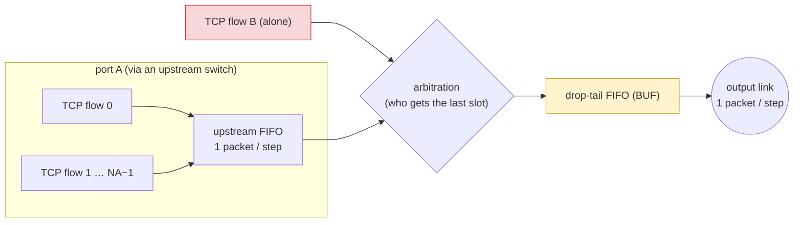

# Case study E: the TCP outcast problem

*Draft, in the style of `draft/case-studies-intro.md`. Model: `buffy/examples/jani/outcast.buffy`;
runs: `experiments/buffy_outcast/`.*

This study is the counterpart of the FQ study (case study B) rather than of the box-based ones (A, D).
The input has state-dependent distributions: closed-loop senders whose sending rate depends on their
own window. The assumptions are bounded-LTL formulas, learned from runs of the compiled model, rather
than a box over load parameters.

**The contention point.** A switch's output port is fed by two input ports. Port A carries several TCP
flows that come through an upstream switch. Port B carries a single flow straight from a host. Prakash
et al. (*The TCP Outcast Problem*, NSDI'12) observed that the lone flow on port B can get much less
throughput than each of port A's flows, although it has a whole port to itself. The intuition says the
opposite: fewer competitors should mean a larger share. The paper attributes this to drop-tail queues
with small buffers and to "port blackout", runs of drops that hit one input port.

**The model** (`outcast.buffy`, about 50–70 state variables; a DTMC).
- **One time step is one packet time.** The output port sends one packet from a drop-tail FIFO of BUF
  packets. Each input port delivers at most one packet per step.
- **Arbitration.** When both ports deliver a packet and the FIFO has room for only one, `ARB`
  decides which one is dropped:
  - 0 / 1: port A / port B always first;
  - 2: a fair coin each step (the default);
  - 3: the last contended step's order again, with probability STICK = 0.9. Persistent timing between
    the ports is the paper's port blackout.
- **Senders.** A coarse closed-loop TCP. A flow with window w sends a packet in a step with probability
  min(w, R)/R, where R = 8 steps is the round trip. This is a state-dependent distribution: a draw in
  a loop over the flows whose condition reads that flow's window. A flow in a timeout sends nothing.
  - Every delivered packet is acknowledged; after w acknowledgements the window grows by one (up to 8).
  - A loss opens a recovery period of R steps. If three later packets of the flow are delivered in it
    (duplicate acknowledgements), the window halves. Otherwise the flow times out: it is silent for
    RTO = 24 steps and restarts with w = 1.
- **Port A's flows** join the upstream FIFO (capacity 8) in a random rotation of their order each step.
  A fixed order would make the last flow a second outcast.
- **POLICY 1** adds a RED-like early drop, one of the remedies the paper evaluates. When the FIFO held
  at least BUF/2 packets at the start of the step, each arriving packet is dropped with probability
  PRED = 0.1.

**The bad event `Q`.** Over the measurement window, steps 80–159 of a 160-step run, the lone flow
receives at most half its fair share: `got_B ≤ W / (2·NF)`, which is 13 of 80 packets at NA = 2.
For contrast, P[starveA] is the same event for a port-A flow.

**Validation** (`validate.sh`, `results/validation.log`).
- **Reduced instances.** NA = 1 and 2, with buffers of 2, R = 2 and a horizon of 10. Exact values from
  `mcsta` (up to 1.9 million states) match the native simulator within its confidence intervals. For
  example, at NA = 2, P[starveB] is 0.3766 exact against 0.3755 ± 0.0021 simulated, and P[starveA0]
  is 0.4204 against 0.4205.
- **Full size.** An independent Python oracle written from the model's description
  (`oc_oracle.py`) agrees with the compiled model, 100,000 runs each:

  | NA | model P[starveB] | oracle | model E[got_B] / E[got_A] | oracle |
  |---|---|---|---|---|
  | 2 | 0.5216 ± 0.0031 | 0.5214 ± 0.0031 | 20.25 / 28.62 | 20.23 / 28.63 |
  | 4 | 0.2357 ± 0.0026 | 0.2359 ± 0.0026 | 15.62 / 15.33 | 15.56 / 15.34 |

## Result 1: where the outcast appears

The table shows P[starveB] / P[starveA], and the expected window deliveries E[got_B] / E[got_A], with a
fair coin and 20,000 runs per point (95% half-width ≤ 0.007):

| BUF \ NA | 1 | 2 | 3 | 4 |
|---|---|---|---|---|
| 4 | 0.35 / 0.34 (36.3 / 36.6) | **0.68 / 0.25** (15.2 / 29.9) | **0.73 / 0.30** (9.5 / 22.1) | **0.65 / 0.33** (8.4 / 16.8) |
| 8 | 0.24 / 0.25 (39.1 / 38.9) | **0.52 / 0.28** (20.3 / 28.6) | 0.38 / 0.30 (16.1 / 20.3) | 0.24 / 0.30 (15.6 / 15.3) |
| 16 | 0.16 / 0.17 (40.0 / 39.8) | 0.24 / 0.33 (28.8 / 24.8) | 0.09 / 0.37 (30.2 / 16.2) | 0.08 / 0.37 (27.4 / 13.0) |

- **NA = 1 is symmetric**, as it must be.
- **Small buffers (BUF = 4).** The lone flow gets about half of what each port-A flow gets, and it is
  starved in two thirds of the windows against a third for port A's flows. This is the outcast.
- **BUF = 8.** The outcast is clear at NA = 2, weaker at 3 and gone at 4. There, port A's own
  upstream FIFO becomes the bottleneck for its flows.
- **BUF = 16.** It reverses: the lone flow does better.

This matches the paper's conditions (drop-tail, small buffers).

**The mechanism in the model.** Port A is busy in about 76% of the steps (NA = 2, BUF = 8), so most
packets the lone flow sends meet a packet from port A. When the FIFO is full, half of those are dropped;
it is full in about 42% of the steps. A port-A packet meets a port-B packet only when B sends (about 33%
of the steps). So per packet the lone flow loses about 2.3 times as often. Its losses are also its own consecutive packets, which
leaves too few duplicate acknowledgements for recovery, so it times out (P[toB] 0.79 against 0.66).
Contention is fair between *ports*, not between *flows*.

**Remedy.** RED-like early drop (POLICY 1, PRED = 0.1) removes the outcast at BUF = 8. P[starveB] /
P[starveA] go from 0.52 / 0.28 to 0.26 / 0.26, with equal means of 24.9. At BUF = 4 it halves the gap,
from 0.68 / 0.25 to 0.44 / 0.27. Early drops hit both ports in proportion to their arrivals, before the
FIFO is full.

**Port blackout is a variance effect.** With sticky arbitration (ARB = 3, NA = 2, BUF = 8), the lone
flow's *mean* is slightly above port A's (27.3 against 25.9). Yet it is starved more often (0.48
against 0.37). Runs of lost contests time it out; runs of won contests let it catch up. A mean-value
analysis would call sticky arbitration fair, or even favourable to the lone flow. The probability of a
starved window says it is not. This is the same kind of finding as Loom's case study (D).

## Result 2: learned temporal conditions

**The method** (`run_learn.sh`; `learn_ltl.py`, `certify.py`).
1. **Traces.** The compiled JANI is stepped natively for 20,000 runs. At every time-step boundary the
   two input atoms are recorded: aA (port A delivered a packet in this step) and aB (port B did).
2. **Candidates.** Bounded-LTL formulas are enumerated over the 8 atom combinations (aA, ¬aA, aA ∧ aB,
   …):
   - `run(p, k, [a, b))` = F (time ∈ [a, b) ∧ p ∧ X p ∧ … ∧ X^(k−1) p), with k up to 8;
   - its negation;
   - conjunctions of two of the best singles.

   The intervals end by step 80, so a condition looks only at the first half and *predicts* Q in the
   second. Conditions over the window itself turned out circular in a closed loop: "B rarely sends"
   implies "B rarely receives".
3. **Scoring.** Formulas are scored on a training half and re-scored on a held-out half. They must be
   mild: P[c] ≥ 0.1.
4. **Certification.** The best four in each direction are certified on 20,000 *fresh* runs (seed 101)
   of the compiled model. Each formula is compiled into the model as a monitor, with 95%
   Clopper–Pearson intervals.
5. **Cross-check of the encodings.** The first two were also certified as Buffy LTL `given` queries,
   which the compiler turns into a deterministic monitor by formula progression. Both encodings give
   identical estimates on the same seed.

**Results at NA = 2, BUF = 8** (base rate P[Q] = 0.522 [0.515, 0.529]):

| condition (first half only) | P[c] | P[Q \| c] (certified) |
|---|---|---|
| port A never idle in steps 40–79, **and** B silent for 6 steps in a row in steps 0–39 | 0.136 | **0.908** [0.897, 0.919] |
| port A never idle in steps 40–79, **and** B silent for 8 steps in a row in steps 40–79 | 0.166 | **0.907** [0.897, 0.917] |
| port A idle for 8 steps in a row in steps 40–79, **and** B sends 4 steps in a row while port A is idle, in steps 0–79 | 0.113 | **0.020** [0.015, 0.027] |
| B never silent for 8 steps in a row in steps 40–79, **and** B sends 4 steps in a row while port A is idle, in steps 40–79 | 0.110 | **0.012** [0.008, 0.017] |

**Reading.**
- **Outcast is a lock-in.** If the lone flow backs off (a silent stretch, i.e. a timeout) while port
  A stays saturated, it stays starved for the next 80 steps with probability 0.91. Once B is out,
  port A's flows grow their windows and keep port A busy. Every packet B then sends meets contention,
  so B's recovery fails again.
- **Recovery needs gaps.** The lone flow recovers through gaps in the *other* port's traffic: a run of
  4 uncontended sends lets it rebuild its window. Then the probability of starvation falls to 1–2%.

These conditions are mild: each holds in 11–17% of runs. They are about the input to the contention
point, the arrival timing at its two ports, and they move P[Q] from 0.52 to 0.91 or to 0.01. As with
FQ, they are temporal patterns, not loads.

**Caveats.**
- **The TCP model is coarse.** Rate-based sending, no delayed acknowledgements, and timeouts after
  most losses at small windows. Timeouts are frequent for every flow (P[toA] 0.66 at NA = 2). The
  qualitative results match the paper; the absolute numbers are this model's.
- **Conditions are not causes.** In a closed loop the "input" is partly a consequence of the bad
  event. Conditions over the first half that predict the second half are the cleanest reading;
  they are predictive, not causal.

## Findings for the tool chain

- **A compiler limitation, fixed.** A draw's condition could not read loop variables, so
  `snd[i] ~ w[i] == 1 ? … : …` in a loop over flows was rejected ("unknown variable 'i'"). The
  condition is resolved after elaboration, outside the loop's scope. The fix records the loop
  variables with each conditional draw (`Elaborate.cpp`, `condLoops`). A regression test,
  `examples/jani/draws_loop.buffy`, is checked against a hand-unrolled copy in 4 layouts.
- **LTL monitor blow-up, fixed.** Buffy used to compile a combined bounded-LTL condition into one
  deterministic monitor by formula progression. Conjunctions of two windowed `F<=80` formulas then
  exceeded the compiler's limit of 100,000 monitor states, because each conjunct carries its own
  countdown. At first, `certify.py` encoded each `run(p, k, [a, b))` as two small monitor variables
  (`mon`). The compiler now factors such conditions into one monitor per subformula (design
  decision 48), so the learned conditions also compile as Buffy `given` queries (`ltl`). For all
  eight conditions the two encodings give identical estimates on the same seed. A single
  condition's factored monitors have 162–621 states, and it compiles in under a second.
- **Learning from the compiled model.** Traces come from the same JANI that certifies the conditions.
  The learner's time alignment is confirmed by the certification, whose fresh-run estimates match the
  held-out ones.

**Reproduce.**
- `run_sweep.sh "NA=2" "NA=2 POLICY=1" …` produces `results/sweep.log`.
- `run_learn.sh "NA=2" 13` produces `results/learn_oc_NA2.log`, `conds_oc_NA2.json` and
  `certify_oc_NA2.log`.
- `validate.sh` produces `results/validation.log`. In that log, the first `Probability` line of each
  `mcsta` block is `starveB`.
