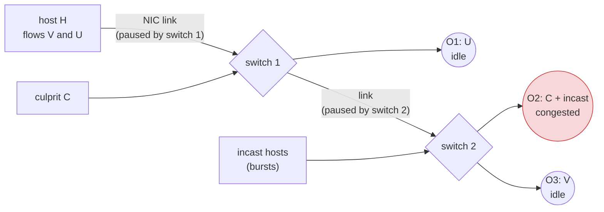

# Case study F: PFC congestion spreading

*Model: `buffy/examples/jani/pfc.buffy`; runs: `experiments/buffy_pfc/` (`run_study.sh`).*

**The contention point.** RDMA fabrics run Ethernet *lossless* with priority flow control (PFC). When
a switch's ingress buffer passes a threshold (XOFF), it tells the upstream sender to *pause* until the
buffer drains to XON. That avoids drops, but a pause stops *every* packet on the link, so congestion
at one port can spread upstream to flows that never go near it. Guo et al. (SIGCOMM'16) report this
from production as congestion spreading and head-of-line blocking.

**The model** (one priority class; every port and link moves one packet per step; 60 steps):
- **Flows.** Host H sends two flows over its one NIC link. V goes to switch 2's idle port O3. U goes
  to switch 1's idle port O1, and never touches switch 2. A culprit C enters switch 1 on another port
  and goes to switch 2's port O2, which an incast from hosts at switch 2 also targets.
- **Switches.** Each switch keeps one FIFO per ingress. The head moves to its egress queue when there
  is room; otherwise it blocks the FIFO (head-of-line blocking). O2 serves its two ingresses in
  alternation.
- **PFC (`PFC = 1`).** Switch 2's ingress from switch 1 pauses switch 1's link to it at XOFF = 4
  packets, until it drains to XON = 1. Switch 1's ingress from H pauses H's NIC the same way. With
  `PFC = 0` the ingresses tail-drop instead (lossy Ethernet).
- **Input.** V, U and C send a packet per step with probability 0.3, 0.3 and 0.5. The incast hosts
  together send a burst of 1–3 packets with probability 0.3 per step: one random draw, so conditions
  on the incast are certifiable with `--condition-on`. O2's offered load is 1.1, slightly overloaded.
- **Measured in the last 30 steps.** V or U is *blocked* in a step if it waits for reasons other than
  its own port: V behind a culprit packet stuck at switch 2's ingress head, or in a paused link or
  NIC; U behind a V packet stuck at switch 1's ingress head (its egress full), or in a paused NIC.
  **Q**: U is blocked in at least 10 of the 30 steps.

**Sources are open-loop** (no rate control such as DCQCN), so these are the dynamics of the switches
and PFC under a given offered load, not of a full RDMA stack.

## Results

**Spreading exists only with PFC, and it is rare** (100,000 runs per point, `results/sweep.log`):

| incast, culprit load | PFC | U blocked (Q) | H ever paused | V blocked ≥ 10 steps | V gets ≤ half its traffic |
|---|---|---|---|---|---|
| 0.3, 0.4 | off | 0 | 0 | 0.32 | 0.026 |
| 0.3, 0.4 | on | 0.00016 | 0.004 | 0.26 | 0.012 |
| 0.3, 0.5 | off | 0 | 0 | 0.64 | 0.086 |
| 0.3, 0.5 | on | **0.0013** | 0.030 | 0.53 | 0.028 |
| 0.4, 0.5 | off | 0 | 0 | 0.78 | 0.120 |
| 0.4, 0.5 | on | 0.0030 | 0.048 | 0.69 | 0.036 |

- **U, which never touches switch 2, is blocked only when pauses spread.** This happens in 0.13–0.30%
  of runs once O2 is overloaded.
- **V is blocked often with or without PFC.** It shares switch 2's ingress buffer with the culprit,
  whose packets wait for the congested O2: head-of-line blocking, which is not PFC's doing.
- **PFC helps V's delivery.** It improves threefold, because without PFC V's packets are dropped in
  that blocked buffer. With open-loop sources, PFC trades drops for blocking. Its cost is the spreading
  to U.

**Learned conditions** (4,000,000 runs, `learn_pfc.py`, `results/learn.log`; certified at incast 0.3
and culprit 0.5, base P(Q) = 0.00155, `results/certify_blkU.log`):

| condition A | P(A) | P(Q \| A) | how certified |
|---|---|---|---|
| the culprit sends in 8 consecutive steps between steps 20 and 40, and never pauses 3 steps in steps 20–50 | 0.0064 | 0.0157 | rejection (two sources) |
| the culprit sends in 6 consecutive steps between 20 and 40, and at least 26 incast packets by step 40 | 0.062 | 0.0076 | rejection |
| at least 42 incast packets by step 50 | 0.061 (exact) | 0.0034 | `--condition-on`; rejection 0.0035 |
| at least 44 by step 50, and no 6 consecutive steps without incast | 0.014 (exact) | 0.0039 | `--condition-on` |
| **at most 14 incast packets by step 40** | 0.064 (exact) | **7.5·10⁻⁵** | `--condition-on` |
| … and at most 30 by step 60 | 0.057 (exact) | 7.0·10⁻⁵ | `--condition-on` |

**Reading.**
- **No short pattern makes spreading likely.** The best conditions reach P(Q | A) ≈ 1.6%, a tenfold
  lift, and need a *persistent culprit*: one that sends without a break for 8 steps. Heavy incast volume
  alone lifts it only twice. Spreading needs a sustained overload of O2 *and* the victims' own packets
  to be in the wrong place when the pauses come. That is a combination of three independent sources,
  which a short formula over one of them cannot capture. This is the case where the recipe's answer is
  "no mild dangerous assumption exists". That is itself useful: the hazard is diffuse, not
  input-pattern driven.
- **The useful assumption is protective.** If the incast brings at most 14 packets in the first 40
  steps (6% of runs), spreading becomes 20 times rarer. The learner's sample had suggested "never";
  certification on 200,000 conditioned runs corrected it to 7.5·10⁻⁵. This is the reason to certify
  learned conditions on fresh runs.
- **Exact conditioning has a cost here.** The incast's state for conditions on counts up to step 50
  is large (step × packets so far × monitor). The conditioned model of the second incast condition is a
  10 MB C file that took several minutes to compile. The reweighting table is emitted as expressions;
  a table primitive in the simulator would remove this cost.

**Validation.** `--condition-on` agrees with rejection where both were run (0.0034 vs 0.0035), and its
exact P(A) matches the rejection estimates. The model's semantics are checked only by these
cross-checks and by the expected limiting cases: without PFC, U is never blocked; at lower load,
spreading vanishes. There is no independent oracle or reference model for this study.

**Reproduce.** `experiments/buffy_pfc/run_study.sh` (about 45 minutes).

