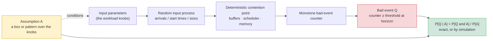
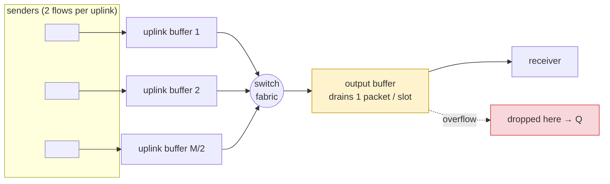
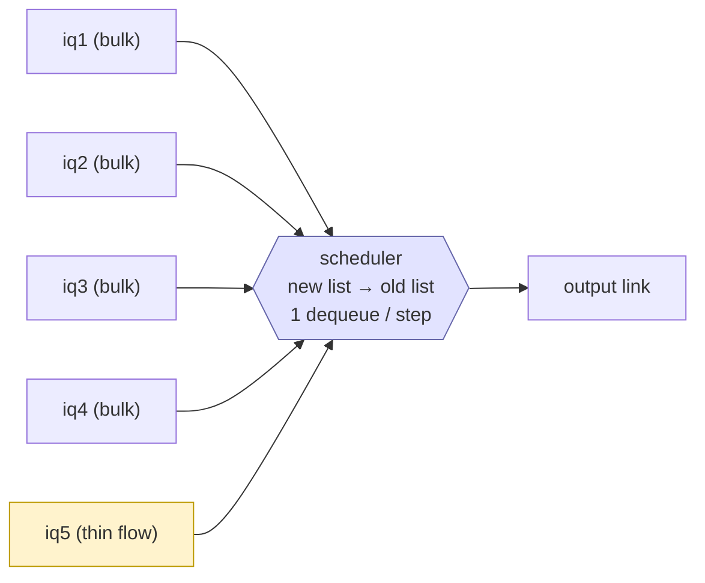
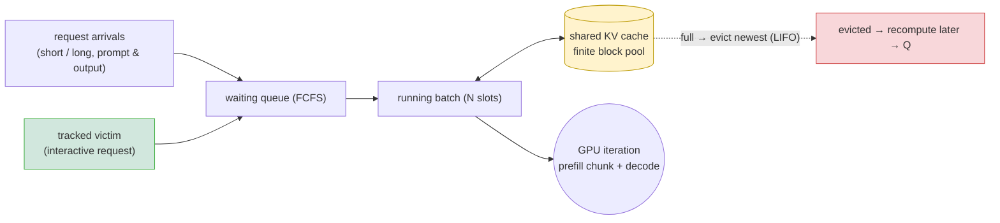
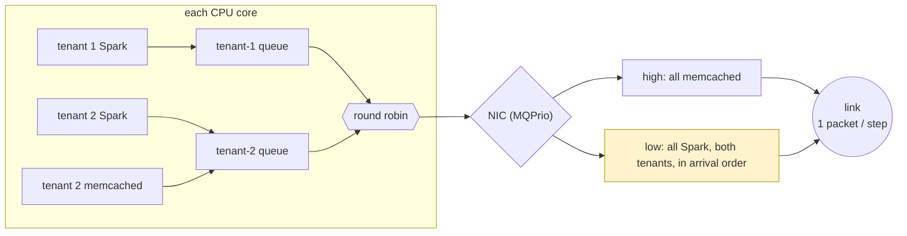
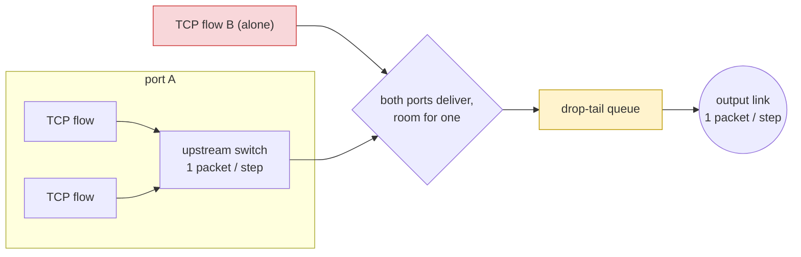

# Case studies: conditional probabilistic reasoning about contention points

*Draft — introductory framing plus one section per case study.*

## 1. The general theme

A network or system has places where many things compete for one shared resource.
A switch buffer that several links feed into. A scheduler that must pick one queue
to serve. A block of GPU memory that many requests share. We call these places
**contention points**. When too much input arrives at once, a contention point
misbehaves: it drops packets, it starves a flow, it evicts a request. We want to
reason about *when* this happens and *how likely* it is.

Testing does not answer this well. A single trace either hits the bad behavior or
it does not, and it tells you nothing about how common that trace is. A worst-case
bound is also unsatisfying: it usually describes an extreme input that a real
system would rarely produce. What an engineer actually wants to know is different.
It is a question about a *class* of inputs: "if the traffic looks roughly like
this, how often does the component break?"

We answer that question with a model and a probability. The recipe is the same in
every case study.

1. **Model the contention point as a discrete-time Markov chain (a DTMC).** We
   write it in [PRISM](https://www.prismmodelchecker.org/). The state is the
   contents of the buffers, queues, or memory, plus a clock.

2. **Put all the randomness in the input.** The only random choices in the model
   are in how the input arrives — when a sender starts, how many packets show up,
   whether the next request is long or short. Once the input is fixed, the
   component itself behaves deterministically: the buffer fills by fixed rules,
   the scheduler picks by fixed rules. This split is deliberate. It means every
   probability we compute is a statement about the *input*, not about hidden coin
   flips inside the hardware.

3. **Describe the input with a few named parameters.** These are the knobs of the
   workload: how many senders, how wide the arrival window, how long each burst,
   how likely a long request is. We call the whole vector of these knobs the input
   description.

4. **Define the bad event `Q` as a property of a run.** In every case study `Q` is
   read off a counter that only goes up (packets dropped, times a queue was
   skipped, times a request was evicted). Because the counter is monotone, "did
   the bad thing ever happen within the horizon" is just "is the counter over its
   threshold at the end." That makes `Q` easy and exact to state as a temporal
   property.

5. **Define an assumption `A` over the input parameters.** `A` is a condition on
   the input description. It can be a *box* — a range for each parameter, like "6
   to 12 senders, any window up to 48 slots, bursts of 16 to 24 packets" — or a
   *pattern* — "a long request arrived just before the one we care about." `A` is
   the thing we want to reason under.

6. **Compute the conditional probability `P[Q | A]`.** PRISM has no built-in
   "given" operator, so we compute it by division:

   ```
   P[Q | A]  =  P[Q and A]  /  P[A]
   ```

   Each query group is three numbers: the base rate `P[Q]`, the joint `P[Q and A]`,
   and `P[A]`. For small models PRISM solves this exactly. For large models the
   state space is too big to solve exactly, so we switch to **statistical model
   checking**: PRISM simulates many runs and returns a confidence interval. Same
   model, same query, only the solver changes.



**What we are really looking for.** The interesting output is not a single number.
It is an assumption `A` that is at the same time *mild* and *dangerous*: a region
of ordinary-looking inputs under which `Q` is still surprisingly likely. Such an `A`
points the engineer at input regimes that are easy to hit in practice but hard to
see by looking at any one part of the system.

One trap: an assumption can look dangerous "on average" while all of its danger sits
in one extreme corner. If you
widen the range to include an input that is obviously bad, the average stays high,
but you have learned nothing new. A good assumption is one whose *worst* included
case is still dangerous — the whole box is bad, not just a skewing corner. Checking
the worst corner is how we tell a real finding from an artifact.

The five case studies below are five contention points that all fit this shape.
They differ in what the shared resource is and in how far along we are.

---

## 2. Case study A — TCP incast at a top-of-rack switch

**The contention point.** A top-of-rack switch sits in front of a receiver. Many
senders reply to that receiver at once, a pattern called *TCP incast*, common
after a distributed query or a storage read. Their traffic arrives on several
**uplink ports**, each with its own small buffer, and all of it converges on the
one **output port** that drains toward the receiver. The output drains one packet
per time slot. Every buffer, on every port, has the same modest capacity (`BUF`,
held at 32 packets, about 48 KB). When more uplinks are backlogged at once than the
output can drain, the output buffer overflows and packets are lost.



**The bad event `Q`.** `Q` is "at least `THRESH` packets were dropped at the output
port" (`THRESH` held at 8, a quarter of a buffer). The model keeps a counter
`odrops` for output-side loss and a separate counter `idrops` for uplink-side loss.
`Q` is `odrops ≥ THRESH`, read at the end of the run:

```
P=? [ F ("done" & odrops >= THRESH) ]
```

**The input parameters.** Three knobs describe the traffic:

| knob | meaning | units |
|------|---------|-------|
| `M`    | number of senders; active uplinks (fan-in) `= M/2` | count |
| `WIN`  | synchronization window; each sender starts at a slot chosen uniformly in `[0..WIN]` | slots |
| `SLEN` | burst length; packets each sender sends back-to-back | packets |

**How the model runs.** It is a DTMC. Each time slot is resolved in sub-stages, one
per sender plus one for service. In the random phase, each sender that has not
started yet starts this slot with a hazard rate chosen so that, overall, its start
time is exactly uniform on `[0..WIN]`. In the service sub-stage, the output drains
one packet, every
backlogged uplink forwards one packet into the output (overflow counts toward
`odrops`), and new packets enter the uplink buffers (overflow counts toward
`idrops`). The run ends when all packets have arrived and drained. So the *only*
randomness is when each sender begins; the contention is a fixed consequence of
those start times.

**The assumptions found so far.** `P[Q]` rises with `M` and `SLEN` and falls with
`WIN`. So the least dangerous point of any box is its corner with the fewest
senders, the widest window, and the shortest burst. Certifying that one corner
certifies the whole box. We report two boxes.

- **Moderate fan-out.** `A = (M in 6..12) and (WIN in 0..48) and (SLEN in 16..24)`.
  Across the whole box, `P[Q] ≥ 0.64`, and the worst corner (`M=6, WIN=48,
  SLEN=16`) still gives `0.64`. The only thing this box pins down is a moderate
  fan-in of at least three uplinks. It does not assume tight synchronization, a
  tiny buffer, or a huge number of senders.

- **Desynchronized short bursts (the stronger result).** `A = (M in 16..20) and
  (WIN in 48..96) and (SLEN in 8..12)`. Here the senders are genuinely spread out:
  the arrival window is up to twelve times the burst length, so at any instant only
  a few of the ten uplinks are sending, and a collision between any two is rare.
  Intuition says a buffer should absorb such scattered short flows. It overflows
  anyway. Across the whole box `P[Q] ≥ 0.54`, and the worst corner (`M=16, WIN=96,
  SLEN=8`) gives `0.54`.

In **both** boxes, `P[idrops ≥ THRESH] = 0`: every uplink buffer stays healthy while
the output buffer overflows.

**Why this supports the paper.** In this case study, the second box is the real
result. Incast is usually explained by synchronization: everyone replies at the same
instant. This shows that synchronization is not required. Enough independent short
flows into one drain will, at some moment, back up enough uplinks at once to
overflow the shared buffer. The danger is aggregate coincidence, not lockstep. And
it is invisible to any per-port check: no single uplink buffer ever looks stressed.
Only a probability over the *whole* box, read at the *output*, reveals it. This is
also the case study where we most clearly
avoid the corner trap: a lazily chosen box that starts at `M=2` has a worst corner
with `P[Q] = 0`, and starting the box at a moderate fan-in is what makes the finding
real.

**Note on method.** These models are too large to solve exactly, so the numbers come
from PRISM in simulation mode (confidence-interval statistical model checking) and
are cross-checked against a plain Monte-Carlo oracle written in Python. At the
hardest corner of the second box the two agree closely (0.538 vs 0.539).

---

## 3. Case study B — flow starvation under a buggy fair-queuing scheduler

**The contention point.** Fair queuing (as in FQ-CoDel) gives each flow its own queue and serves
them in turn. It also favours *sparse* flows: a queue that has just become active joins a "new" list
that is served before the "old" list of long-running flows. The scheduler in the Buffy paper has a
bug here. When a new queue is emptied, it should move to the old list (RFC 8290's rule); instead it
simply leaves both lists. Its next packet then makes it "new" again, and it jumps ahead of everyone
once more. We model one such scheduler with **five input queues and one dequeue per time step**,
over 14 steps.



**The input.** Queues `iq1..iq4` are bulk flows: each receives 0 to 4 packets per step, uniformly.
`iq5` is a thin flow: no packet with probability `P0`, otherwise 1 to 4. We study two settings: a
uniform one (`P0` = 0.2) and a sparse one where the thin flow is idle 60% of the time (`P0` = 0.6).

**The bad event `Q`.** `Q` is "the thin flow is served at least 4 times while all four bulk queues are
waiting". Taking turns among five backlogged queues, the thin flow could be served at most 3 times
in 14 steps, so `Q` means it overtook the bulk flows through the bug, and they starved. `Q` is rare:
3.6·10⁻⁴ in the uniform setting, 1.2% in the sparse one. With RFC 8290's rule added, it falls to
4·10⁻⁶ and 5·10⁻⁴.

**How the assumptions are found.** We record the input of millions of simulated runs, and let a
learner search bounded temporal formulas over the thin flow's arrivals for conditions that make `Q`
likely or impossible. Examples are "at most 1 packet in the first 5 steps" and "single packets in two
consecutive steps". Each candidate is then certified on the compiled model. The compiler builds
a version of the model whose runs all satisfy the condition, with exactly the right probabilities.
That gives the exact probability of the condition and a cheap, precise `P[Q | A]` even when `A` is
rare. Where we could afford it, we checked these against the old way (simulating everything and
keeping the runs that satisfy `A`). They agree.

**Finding 1 — only the thin flow's timing matters.** No condition on the bulk flows' arrivals
changes `P[Q]` at all. The anomaly is determined by how the thin flow sends.

**Finding 2 — a quiet start followed by single packets.** In the sparse setting (base 1.2%):

| assumption `A` on the thin flow | `P[A]` | `P[Q \| A]` |
|---|---|---|
| at most 1 packet in the first 5 steps | 14% | 6.9% |
| … and at most 2 in the first 7 | 7.9% | 9.7% |
| at most 1 in the first 5, then single packets in two consecutive steps | 1.1% | 29% |
| at most 1 in the first 6, then single packets in two consecutive steps by step 10 | 0.33% | **50%** |

While the thin flow is quiet, the bulk queues fill up. After that, every single packet it sends is
served at once and empties its queue, so its next packet makes it "new" again. The first row is the
condition we had picked by hand; the learner confirms it and sharpens it.

**Finding 3 — in the uniform setting, no mild condition is dangerous.** Conditions that hold in 5%
of runs raise `Q` only 20-fold, to 0.7%. Making `Q` likely takes a rare input: "at most 1 packet in
the first 5 steps" holds in 0.19% of runs and gives `P[Q | A]` = 16%. This is exactly the "rare `A`"
difficulty, and exact conditioning removes it: estimating `P[Q | A]` here costs about 500 times fewer
runs than discarding the runs that violate `A`.

**Finding 4 — mild conditions that rule `Q` out.** If the thin flow sends something in each of its
first four steps (41% of runs in the uniform setting), or is never silent twice in a row (73%), `Q`
did not occur in a million runs. A flow that builds up a backlog early sits in the old list and waits
its turn.

**Finding 5 — possible is not the same as likely.** In twenty million runs, every run with `Q`
started quietly: at most 3 thin-flow packets in the first 6 steps. A solver that checks every possible
workload (Buffy's SMT backend, the style of question FPerf asks) disagrees that a quiet start is
needed: it finds workloads with a loud start that still trigger the bug. Both are right. Those
workloads exist, but together they have probability below 2·10⁻⁷, against 3.6·10⁻⁴ for `Q` itself.
More than 99.9% of the bug's probability lies in the quiet-start region. The existential answer says
"both kinds of input can trigger it"; the probabilistic answer says which one matters.

**The remedy.** With RFC 8290's rule added, even the most dangerous input profiles become harmless:
50% → 0.27% and 16% → 0.06%.

**Why this supports the paper.** It shows the recipe on a scheduler, with assumptions that are
temporal patterns of the input, not ranges of loads, and that are *learned* and then *certified*. It
also shows why exact conditioning matters: the conditions that make a rare bug likely are themselves
rare, and only exact conditioning measures them cheaply. (Details: `docs/notes/case-study-fq.md`.)

---

## 4. Case study C — the LLM inference batch scheduler

*This is the newest case study. We have refined the model but do not yet have a
validated assumption. The candidate findings below are exploratory.*

**The contention point.** A single GPU serving a large language model runs many
requests at once with **continuous batching**: it rebuilds the batch every
iteration, admitting and evicting requests between steps so no slot idles. Each
running request keeps its context in a shared, finite block of GPU memory called the
**KV cache**. That memory grows by one token's worth per request per step and is the
resource everyone contends for, the direct analog of a shared buffer. Two modern
features shape the dynamics. **Chunked prefill** slices a long prompt into pieces so
that reading a prompt never freezes the other requests' token generation. And under
memory pressure the scheduler **evicts** a running request, freeing its memory to be
recomputed later; under first-come-first-served admission it evicts the
newest-admitted request first (last in, first out).



**The bad event `Q`.** We follow one interactive "victim" request and watch for three
bad outcomes, each a monotone counter read at the horizon: the victim is **evicted**
at least once (`v_preempts ≥ 1`); the victim's worst gap between output tokens
reaches an SLO threshold, a **time-between-tokens stall** (`v_maxgap ≥ SLO_TBT`); or
total evictions across all requests reach a **cascade** threshold
(`preempts ≥ K_CASC`). Because chunked prefill removes the freeze-the-batch
pathology, the residual risk we study is memory-driven: the victim stalls because it
was evicted, or because it waited behind long requests for a batch slot.

**The input parameters.** The workload knobs are the arrival process and the request
shapes: `p_arr` (probability a background request arrives in an iteration), and the
probabilities that an arrival has a long prompt and a long output (`p_lp`, `p_ol`,
drawn independently in the current model). Fixed design constants describe the
engine: the KV pool size (`KV_CAP`), the number of batch slots (`N_SLOTS`), the
chunk size, and the policy (first-come-first-served, or a priority policy that
protects the victim). Lengths are measured in 16-token memory blocks; time is
measured in engine iterations.

**How the model runs.** It is a DTMC. One engine iteration is a fixed sequence of
sub-stages: inject the victim if it is its arrival time, draw any background arrival
(the only random step), admit waiting requests into free slots, advance each running
request by one chunk of prefill or one decode token, and finally evict the
top-scored request while memory is over capacity. The horizon is 10 iterations.

**Where the model stands.** There are two variants. An earlier one gave the victim a
privileged, dedicated slot; a later one makes the victim an ordinary competing
request with a real waiting queue and independent prompt and output lengths. Moving
to the more faithful variant changed the picture in an instructive way, which is why
we report no assumption yet:

- In the privileged model, a candidate condition — "a long request arrived *before*
  the victim and none after" — lifted the eviction rate from a base of about `0.14`
  to about `0.40`, while the same long request arriving *after* the victim gave a
  rate near zero (it shielded the victim). The story was timing and shape, not
  volume: last-in-first-out eviction turns an early long prompt into the reason the
  later interactive request becomes the eviction target.

- In the faithful model, with realistic slot limits, the victim can no longer be
  evicted at all in the small configuration, so that bad event becomes unreachable
  and its earlier finding is partly an artifact of the privileged setup. The
  surviving bad event is the queueing stall, and the analogous timing condition
  gives a smaller lift, roughly `0.11` to `0.22`.

These lifts are moderate — about 2.8-fold in the privileged model and about 2.0-fold
in the faithful one — computed on a deliberately small, exactly checkable
configuration whose absolute sizes are toy; only the *ratios* between quantities
(memory oversubscription, long-to-short prompt ratio) are meant to be faithful.
Finding a *mild* condition that makes a bad event *clearly* probable, and confirming
it at a realistic scale with simulation, is the open work here.

**How `P[Q | A]` is formed.** As in the other studies, each group is three queries —
base, joint, condition — and the conditional is joint over condition. The conditions
are patterns over the arrival history, tracked by input-feature variables set when
each request arrives (whether a long request came before or after the victim, how
many long requests there were).

**Why this supports the paper.** This is the recipe carried to a very different
domain: an AI serving system rather than a network switch. The shared resource is
GPU memory, the input is a stream of prompts of unknown length, and the bad event is
a latency-SLO violation. The same modeling pattern still applies: random input, a
deterministic scheduler, monotone bad-event counters, and conditional queries. That
it applies here at all is part of the argument that this way of reasoning is general. It also gives
an honest example of the method working *as a check on the modeler*: the more
faithful model revoked a finding that the privileged model had suggested. A single
trace would never have shown that. A probability over the input space did.

---

## 5. Case study D — tenant isolation on a multi-queue NIC

**The contention point.** A server's network card sends packets for two tenants over
one link. Tenant 1 runs a Spark job. Tenant 2 runs Spark and memcached. The intended
policy has two levels: the two tenants share the link fairly, and *inside* tenant 2,
memcached (latency-sensitive) goes before tenant 2's own Spark traffic. This is the
policy that the Loom paper (NSDI'19) argues a NIC should support.

Linux's standard multi-queue configuration, MQPrio, cannot express two levels. The
closest it gets is to put every memcached packet into a high-priority NIC queue and
every Spark packet, of either tenant, into one low-priority queue, with strict priority
between the two. So memcached is prioritized over *tenant 1's* traffic too, and the
low-priority queue mixes the two tenants first-come first-served. We model this pipeline
exactly as the FPerf tool does: per CPU core, one queue per tenant and a round robin
between them, then the NIC's two priority queues, one packet out per time step.



**The bad event `Q`.** Look at a window of 20 time steps after the system has warmed up.
`Q` is "tenant 1 had packets waiting at every step of the window, yet it received at
most 40% of the packets sent" (its fair share is 50%). The "waiting" part matters: a
tenant that simply has nothing to send is not being treated unfairly.

**The input parameters.** Three knobs: the offered load of tenant 1's Spark (`ρ1`), of
tenant 2's Spark (`ρ2`), and of memcached (`ρm`), each as a fraction of the link. Each
core's flow sends a packet per step with a fixed probability, so the only randomness is
in the arrivals; the NIC and the queues are deterministic.

**How the model is built and checked.** This model is written in Buffy and compiled,
not written by hand. A switch selects the NIC policy: MQPrio, or the intended
two-level policy (round robin between the tenants, memcached first inside tenant 2);
everything before the NIC is identical. The MQPrio version is *proven* equivalent to
FPerf's hand-written model of the same pipeline: for every possible input, over short
runs, the two forward exactly the same packets. The numbers come from a fast native
simulator (20,000 runs per point), and an independent Python simulator written from
FPerf's description agrees at every point we compared.

**Finding 1 — MQPrio is unfair even without memcached.** With both tenants offering
60% of the link and no memcached at all, the two tenants get exactly the same average
share. Yet tenant 1 is starved (`Q`) in **18%** of windows. The cause is the shared
first-come first-served Spark queue: over a short window, which tenant's packets happen
to arrive first is a coin flip, and the shares drift. The intended policy alternates
between tenants and is never starved. An average-based analysis would call MQPrio fair
here; only the probability over windows shows the problem.

**Finding 2 — a small memcached share makes it likely.** Adding memcached at 10% of the
link costs tenant 1 only 5% of its *average* share, but doubles its chance of starvation
(18% → 37%). The probability keeps climbing with the memcached share: 27% at 5%, 48% at
15%, 58% at 20%. The intended policy stays at zero throughout.

**The assumption found.** `A = (ρ1 in 0.5..0.6) and (ρ2 in 0.6..0.7) and (ρm in 0.1..0.2)`:
both tenants want at least half the link, tenant 2's Spark is at least as heavy as
tenant 1's, and memcached is a modest 10–20% of the link. `P[Q]` goes up with `ρm` and
`ρ2` and down with `ρ1`, so the least dangerous point of the box is its corner
(`ρ1=0.6, ρ2=0.6, ρm=0.1`), which gives **0.37**. Across the whole box, `P[Q] ≥ 0.37`
under MQPrio and 0 under the intended policy. For contrast, the *obvious* region is a
heavy memcached load: at `ρm = 0.5` starvation is nearly certain (0.94), which anyone
would predict from strict priority.

**Why this supports the paper.** It carries the recipe to a NIC, and the contention point
is a *policy mismatch*: a two-level intent forced into a one-level priority scheme. The
finding is mild and non-obvious in the sense the paper cares about. The danger appears
at a memcached share an operator would consider harmless, and a third of it is present
with no memcached at all, invisible to any average. It also shows the tool working from
a compiled model that is checked against an independent hand-written one, rather than a
model written directly in PRISM. (Details: `docs/notes/case-study-loom.md`.)

---

## 6. Case study E — the TCP outcast problem

*Like case study B, the assumptions here are temporal patterns of the input, learned from runs,
rather than a range of loads.*

**The contention point.** A switch's output port is fed by two input ports. Several TCP flows
come in on port A, through an upstream switch. One flow comes in alone on port B, straight from a
host. You would expect the lone flow to do well: it has a whole port to itself. Prakash et al.
(NSDI'12) found the opposite and called it the *TCP outcast problem*: with drop-tail queues and
small buffers, the lone flow can get far less than each of the flows that share port A.



**The input, and why it is different here.** The senders are TCP: each one sends faster when its
window is large and backs off when it loses packets. So a sender's traffic distribution depends on
its own state, and the input is no longer independent of what the switch does. A lost packet slows
its sender down, which changes the traffic the switch sees next. We model a simple TCP: each flow
sends a packet in a step with probability proportional to its window. The window grows with every
acknowledged window's worth of packets and halves after a loss. If a loss cannot be repaired
quickly, because too few later packets get through, the flow times out: it goes silent for a while
and restarts with the smallest window.

**The bad event `Q`.** Over the second half of the run, the lone flow receives at most half its
fair share of the link.

**How the model is built and checked.** The model is written in Buffy and compiled. On small
instances, exact model checking matches the simulator. At full size, an independent simulator,
written from the model's description, gives the same answers (for example 0.5216 against 0.5214).

**Finding 1 — the outcast appears with small buffers.** With a 4-packet buffer and two to four
flows on port A, the lone flow is starved in about 70% of runs, against about 30% for a flow on
port A. On average it gets half as much. With a 16-packet buffer the effect reverses. The
mechanism: port A almost always has a packet waiting, so nearly every packet the lone flow sends
has to compete for the last slot in the queue. A packet from port A competes only when the lone
flow happens to send. Contention is fair between *ports*, not between *flows*. Random early drops
(RED), one of the paper's remedies, remove the effect at an 8-packet buffer.

**Finding 2 — "port blackout" shows in the tail, not the mean.** The paper blames runs of drops
that hit one port. When we make the switch's tie-breaking sticky, the lone flow's *average* share
is actually slightly higher than port A's flows' (27.3 against 25.9 packets). Yet it is starved more
often (48% against 37%). Runs of lost ties time it out; runs of won ties let it catch up. An
analysis of averages would call this fair.

**The assumptions found.** We let a learner search a family of bounded temporal formulas over
one thing: which ports delivered a packet at each step. It looks only at the *first* half of the
run and keeps formulas that predict `Q` in the second half and hold in at least 10% of runs. Each
candidate was then re-checked on fresh runs of the compiled model. The base rate is 0.52. Two
results:

- *Lock-in.* "The lone flow went silent for several steps in a row (a timeout), and port A was never
  idle from step 40 to 80" holds in 14% of runs. Given it, the lone flow is starved with probability
  **0.91**. Once it backs off while port A stays busy, every packet it sends meets contention, and it
  rarely recovers.
- *Escape.* "Port A was idle for 8 steps in a row, and the lone flow sent 4 packets in a row while it
  was idle" holds in 11% of runs. Given it, the probability falls to **0.02**. The lone flow recovers
  only through gaps in the *other* port's traffic.

**Why this supports the paper.** It is the closest counterpart to the FQ study, carried further.
The input is state-dependent (closed-loop senders), and the assumptions are learned bounded-LTL
formulas over the input's timing, not boxes of loads. They are mild (11–17% of runs) and move `P[Q]`
from 0.52 to 0.91 or to 0.02. It also shows a limit to be honest about. In a closed loop the input
is partly a *consequence* of the bad event: "the lone flow rarely sends" trivially predicts "the lone
flow rarely receives". So the conditions are restricted to an earlier part of the run. They are
predictive, not causal. (Details: `docs/notes/case-study-outcast.md`.)

---

## 7. What ties the five together

| | contention point | shared resource | bad event `Q` | input knobs | assumption found |
|---|---|---|---|---|---|
| **A. Incast** | ToR switch output port | buffer capacity | ≥ `THRESH` packets dropped at output | senders, window, burst length | two mild boxes, `P[Q] ≥ 0.54–0.64` across the whole box |
| **B. Buggy FQ** | fair-queuing scheduler | one dequeue per step | thin flow overtakes the waiting bulk flows ≥ 4 times in 14 steps | the thin flow's arrival timing | learned temporal patterns (quiet start, then single packets): `P[Q \| A]` up to 0.50 (sparse) / 0.16 (uniform), certified by exact conditioning; mild patterns that rule `Q` out |
| **C. LLM scheduler** | GPU batch scheduler | KV-cache memory | victim evicted / stalled / cascade | arrival rate, prompt and output lengths | timing/shape candidates, not yet validated |
| **D. Multi-queue NIC** | NIC transmit scheduler | link share | tenant 1 waiting yet ≤ 40% of a 20-step window | per-tenant and memcached loads | one mild box, `P[Q] ≥ 0.37` across the whole box (0 under the intended policy) |
| **E. TCP outcast** | switch output port, two input ports | queue slots under contention | lone flow gets ≤ half its fair share in the second half | closed-loop TCP senders; arrival timing at the two ports | learned temporal patterns: `P[Q \| A]` 0.91 (lock-in) or 0.02 (gaps on the other port), from a base of 0.52 |

Every row is the same picture. The randomness lives in the input. The component is a
deterministic reaction to that input. The bad event is a monotone counter. The
question we answer is a conditional probability: *given inputs that look like `A`, how
often does `Q` happen?* The tool searches the space of `A` for regions that are mild
yet dangerous: the input regimes a designer most needs to know about but can least
easily see from any one component.
